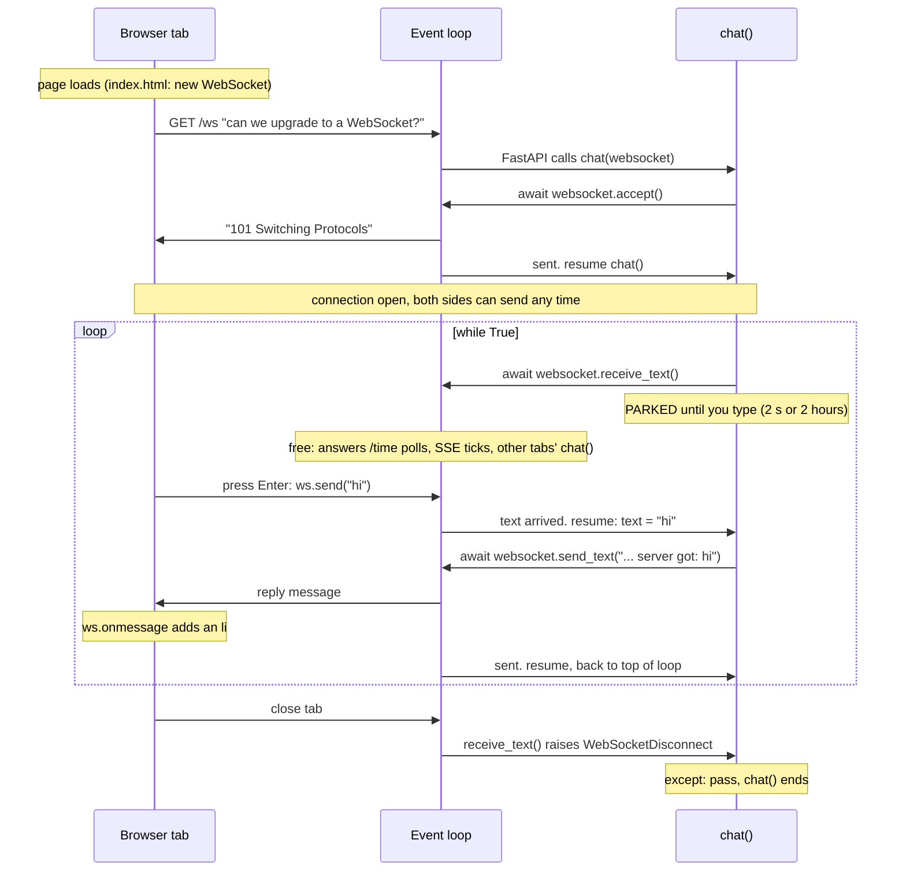
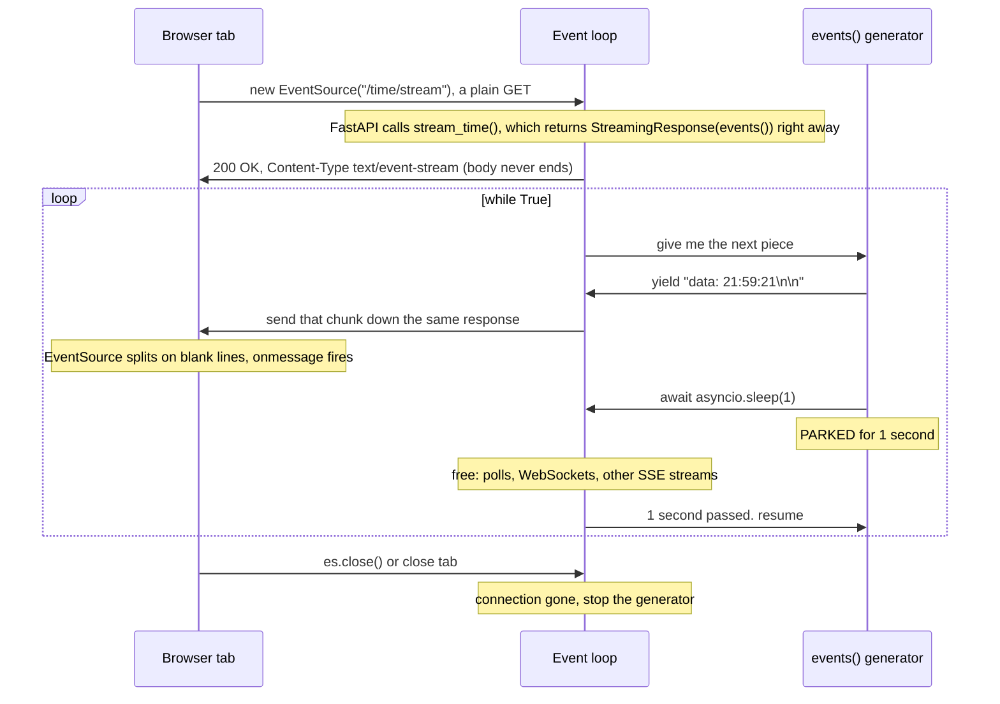

# 05: Polling, SSE and WebSockets (and what `await` does)

Three ways for a browser to get updates from a server, built side by side in a scratch
demo (`scratch/` is gitignored, so the code is copied below). The app itself uses
polling (see the video flow in the README); this note is about the alternatives.

## The three, in one table

| | How it works | Direction | Typical use |
|---|---|---|---|
| **Polling** | The browser asks "anything new?" on a timer; each ask is a normal request | Browser asks, server answers | Job status, refreshing dashboards |
| **SSE** | One GET whose response never ends; the server keeps adding `data:` lines | Server → browser | Progress bars, notifications, LLM text streaming |
| **WebSocket** | The GET is upgraded (HTTP 101) to a two-way connection | Both ways | Chat, multiplayer games, collaborative editing |

How to choose: rare updates and some delay is fine → polling. Server pushes live →
SSE. Both sides talk live → WebSocket.

## The demo

Run from the repo root (in the dev container):

```bash
uv run uvicorn polling_and_such:app --app-dir scratch --reload --port 8001
# open http://localhost:8001
```

Backend, `scratch/polling_and_such.py`:

```python
import asyncio
from datetime import datetime
from pathlib import Path

from fastapi import FastAPI, WebSocket, WebSocketDisconnect
from fastapi.responses import FileResponse, StreamingResponse

app = FastAPI()

def now() -> str:
    return datetime.now().strftime("%H:%M:%S")

# 1. Polling: one request, one answer. The browser repeats the request itself
@app.get("/time")
def get_time() -> dict:
    return {"time": now()}

# 2. SSE, one request, but the response never finishes
# Each 'yield' sends one more message down the same response
@app.get("/time/stream")
def stream_time() -> StreamingResponse:

    async def events():
        while True:
            yield f"data: {now()}\n\n"
            await asyncio.sleep(1)

    return StreamingResponse(events(), media_type="text/event-stream")

# 3. Websocket: one connection that stays open
# The browser sends a message, and the server replies on the same connection
@app.websocket("/ws")
async def chat(websocket: WebSocket) -> None:

    await websocket.accept()
    try:
        while True:
            text = await websocket.receive_text()
            await websocket.send_text(f"{now()} server got: {text}")

    except WebSocketDisconnect:
        pass

@app.get("/")
def index() -> FileResponse:
    return FileResponse(Path(__file__).parent / "index.html")
```

Frontend, the script part of `scratch/index.html`:

```js
// Polling: a new request every second.
let timer, requests = 0
$("poll-start").onclick = () => {
  clearInterval(timer)
  timer = setInterval(async () => {
    const data = await (await fetch("/time")).json()
    $("poll-time").textContent = data.time
    $("poll-info").textContent = `(${++requests} requests so far)`
  }, 1000)
}
$("poll-stop").onclick = () => clearInterval(timer)

// SSE: one request; onmessage runs each time the server sends a line.
let es, messages = 0
$("sse-start").onclick = () => {
  es?.close()
  es = new EventSource("/time/stream")
  es.onmessage = (e) => {
    $("sse-time").textContent = e.data
    $("sse-info").textContent = `(1 request, ${++messages} messages)`
  }
}
$("sse-stop").onclick = () => es?.close()

// WebSocket: connect once, then send and receive on the same connection.
const ws = new WebSocket(`ws://${location.host}/ws`)
ws.onmessage = (e) => {
  const li = document.createElement("li")
  li.textContent = e.data
  $("ws-log").append(li)
}
$("ws-text").onkeydown = (e) => {
  if (e.key === "Enter") {
    ws.send(e.target.value)
    e.target.value = ""
  }
}
```

The browser never knows the Python function names. It only knows URLs (`/time`,
`/time/stream`, `/ws`); the decorators map those URLs to functions, and FastAPI calls
the function and passes in what its type hints ask for (`websocket: WebSocket`).

## `async` / `await` and the event loop

- FastAPI runs on **one event loop thread** shared by every connection.
- `async def` marks a function that may pause. `await` goes on the *call* and means
  "I'm waiting on something outside my program (network, timer); run other code and
  wake me when it's ready." The function itself pauses; the *program* keeps going.
- An `async def` function only runs when awaited. Calling `websocket.receive_text()`
  without `await` just creates a coroutine object that never executes.
- Plain `def` endpoints (like `get_time`) run in a thread pool, so they can't freeze the loop.

What each `await` in the demo waits on:

| Call | Waits for | Usually |
|---|---|---|
| `websocket.accept()` | reading the connect request, writing the "101 Switching Protocols" reply | microseconds |
| `websocket.receive_text()` | the user to type something | seconds to hours: the one that matters |
| `websocket.send_text()` | room in the OS send buffer for that connection | instant; waits only for a slow client |
| `asyncio.sleep(1)` | a timer | exactly 1 s |

"Sent" means handed to the OS, not "the browser confirmed it". TCP handles delivery
and acknowledgements underneath; Python never sees them.

## WebSocket: what happens when you press Enter



## SSE: what happens when you press Start

No handshake and no upgrade: one ordinary GET whose response never finishes.



| | SSE | WebSocket |
|---|---|---|
| Starts with | plain GET, normal 200 | GET asking to upgrade, 101 |
| Server code | `yield` lines from a generator | `accept()`, then `receive_text()` / `send_text()` |
| Direction | server → browser only | both ways |
| Parked on | a timer here | the user |
| Connection drops | EventSource reconnects on its own | you write the reconnect |

## Bugs we hit (on purpose and not)

- **Removed the `await`s in `chat()`**: the server froze. Without `await`, `receive_text()`
  and `send_text()` never ran, so `while True` spun with nothing that hands control back.
  One CPU core went to 100% and every connection stalled. The log showed
  `RuntimeWarning: coroutine 'WebSocket.receive_text' was never awaited`, once per line
  of code (Python prints each warning once).
- **`time.sleep(1)` instead of `await asyncio.sleep(1)`** would freeze the loop for that
  second. With one SSE tab it looks fine; with two tabs or a WebSocket open, everything
  stalls.
- **`Address already in use`**: an old server still held port 8001. Ctrl+Z *suspends* a
  process (it keeps the port); Ctrl+C quits it. A frozen server (spinning loop) or an
  open SSE stream can also stop Ctrl+C or `--reload` from finishing. Find it with
  `ss -ltnp | grep 8001`, kill the PID. `--timeout-graceful-shutdown 1` stops uvicorn
  waiting forever on open streams.

## What this would mean for the app

Both of the app's loops poll every second: the worker asks the db for jobs, the browser
asks the api for status. SSE fits job progress (one-way), but the api would still poll
the db behind it. Removing polling for real means Postgres `LISTEN/NOTIFY`: the worker
`NOTIFY`s on job changes, the api `LISTEN`s and pushes over SSE. Saved as a design
exercise for the next project.
